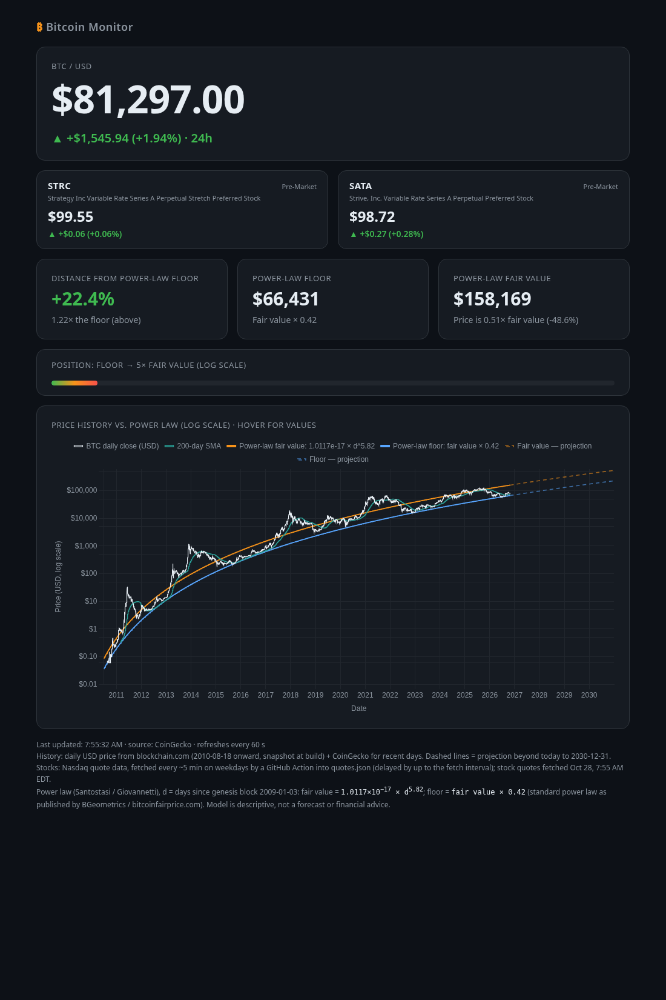

# btc-dashboard

Static single-page Bitcoin dashboard, live at https://rhoffman721.github.io/btc-dashboard/.

- Live BTC price and 24h change (CoinGecko, falling back to Coinbase/Kraken).
- Power-law fair value = 1.0117e-17 × d^5.82, floor = fair value × 0.42 (standard power law as published by BGeometrics / bitcoinfairprice.com). `d` = days since 2009-01-03.
- Log-scale history chart from 2010 with a 200-day SMA and dashed projections to 2030.
- 60s auto-refresh.
- STRC and SATA quotes come from Nasdaq's public quote API via a GitHub Action that refreshes quotes.json every ~5 minutes on weekdays.

GitHub Pages: Deploy from branch `main`, folder `/ (root)`.
